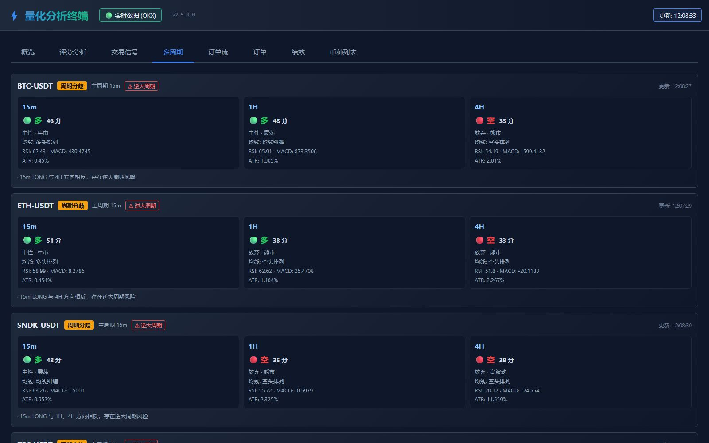
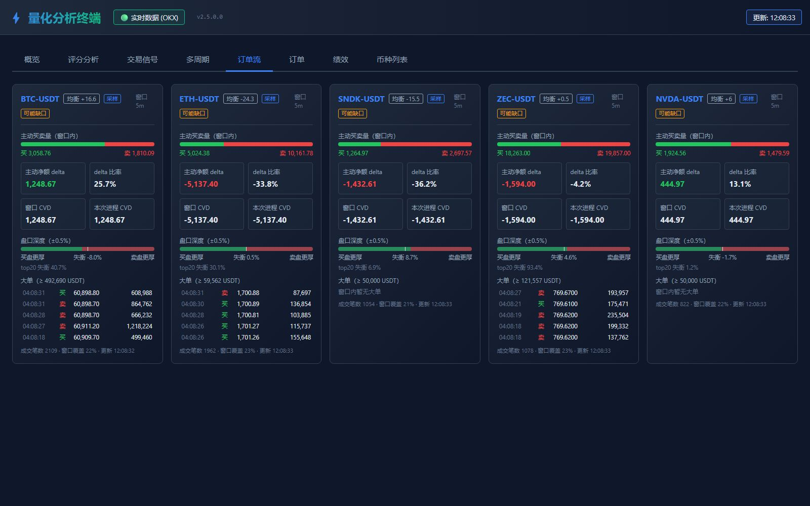
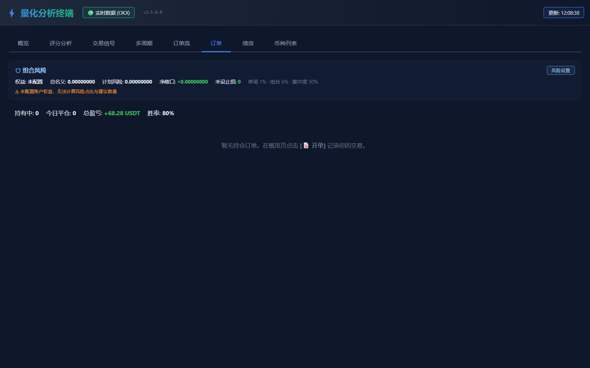
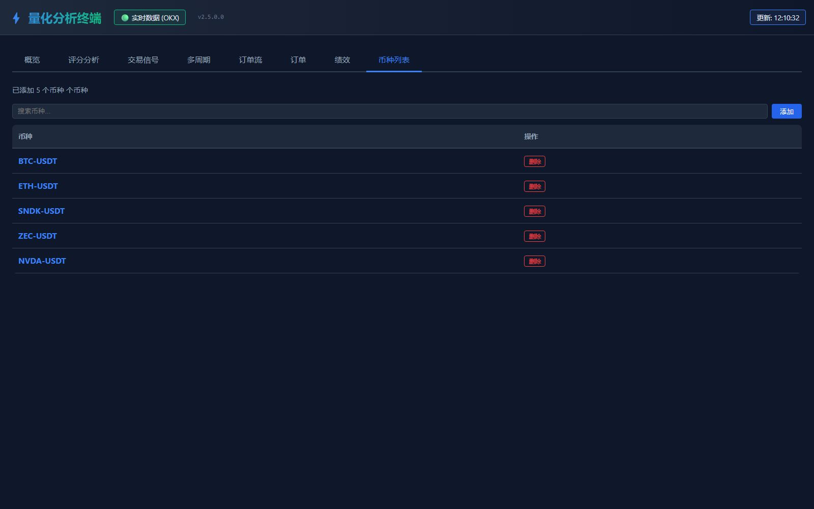

# 量化分析终端 · OKEworkplace

一个面向 OKX 永续合约的**本地行情分析与决策辅助工具**：把实时行情、综合评分、交易信号、多周期、订单流、手工记账、风险与绩效复盘集中在一个界面里。

> **它不做什么**：不自动下单、不托管资金、不连接交易权限、不构成投资建议。
> 交易仍由使用者在 OKX 手机端手工完成，程序负责给出结构化的判断依据与风险提示。

  
  
  
  

---

## 界面一览

### 概览

一屏看完所有关注币种的当期状态：方向、综合评分、置信度、买卖价、MACD、多周期方向与关键位。
卡片右下角的「开单」只用于**本地记账**，不会向交易所发送任何订单。

### 评分分析

按币种查看综合评分的分项构成、风险等级与当前结论。分值越高代表多维信息越一致，不代表保证盈利。

### 交易信号

只列出当前值得关注的机会：方向、触发的条件清单、评分、风险等级、置信度，以及方向是否刚刚发生变更。

### 多周期

同一币种在 15 分钟、1 小时、4 小时三个周期上的方向与评分，用于判断共振或分歧，并提示是否在逆大周期操作。

### 订单流

按币种展示主动买卖压力、净额与比率、CVD、盘口深度失衡、最近大单与采样覆盖情况，帮助判断短周期资金方向。

### 订单与风控

本地手工记账与组合风险面板：总名义价值、计划风险、净敞口、未设止损数量、单笔/组合风险占比与集中度。
持仓可设置止损止盈，价格触及时会生成提醒事件（仅提醒，不代为下单）。

### 绩效

对历史信号做回验统计：胜率、方向准确率、平均净收益，并按币种、周期、多周期共振、订单流偏向分桶，用来评估「这套判断在什么环境下更可靠」。

### 币种列表

管理关注列表：搜索、添加、移除与别名维护。所有页面都基于这份列表刷新。

---

## 功能地图

| 页面 | 你会看到什么 | 适合用来做什么 |
|---|---|---|
| 概览 | 方向、评分、置信度、买卖价、MACD、多周期方向、关键位 | 快速扫一遍市场，找出值得进一步看的币种 |
| 评分分析 | 综合评分、分项表现、风险等级 | 理解某个币种为什么得分高或低 |
| 交易信号 | 条件清单、方向、评分、风险、置信度 | 决定今天有哪些机会值得人工复核 |
| 多周期 | 15m / 1H / 4H 的方向与评分、共振或分歧 | 避免只看单一周期造成误判 |
| 订单流 | 主动买卖量、净额、CVD、盘口失衡、大单 | 判断短周期资金是偏多还是偏空 |
| 订单 | 组合风险、手工持仓、止损止盈、平仓统计 | 记录自己的交易并控制风险 |
| 绩效 | 胜率、方向准确率、平均净收益、分类分桶 | 复盘这套判断在不同环境下的表现 |
| 币种列表 | 关注币种与别名 | 定制自己关心的市场范围 |

---

## 页面上的参数是什么意思

### 方向与评分

| 字段 | 含义 |
|---|---|
| 方向 | 当前判断：**做多 / 做空 / 中性**；中性表示多空信息不一致，建议观望 |
| 评分 | 0-100 的综合分，由**趋势、动量、成交量、持仓量、资金费率**五类市场信息综合而成；分数越高代表各类信息越一致 |
| 档位 | 界面会给出文字档位（如强势 / 中性 / 弱势），用于快速理解分数区间，而不是精确的交易阈值 |
| 置信度 | 当前判断所依据的条件完整度与一致度，百分比越高表示依据越充分 |
| 风险等级 | 低 / 中 / 高，综合波动与位置给出，仅作提示 |
| 方向变更 | 该币种的方向刚刚发生切换，需要重新评估而不是沿用旧结论 |

> 评分是「信息一致程度」的度量，不是收益预测；分数高也可能亏损，分数低也可能上涨。请结合风险与自身规则使用。

### 行情与指标

| 字段 | 含义 |
|---|---|
| 买价 / 卖价 | 当前盘口最优买价与卖价；两者之差为价差 |
| MACD | 动量指标，界面同时显示数值与多头/空头状态，用于观察动能变化 |
| RSI | 相对强弱指标，界面标注超买 / 超卖 / 健康区间 |
| EMA | 指数均线，界面提示价格与均线的相对位置及排列关系 |
| ATR | 平均真实波幅，用于衡量近期波动大小 |
| 标记价 / 指数价 / 价差 | 合约标记价格、现货指数价格，以及两者的偏离 |
| 关键位 | 近期支撑/阻力参考位，以及当前价格距该位的百分比 |
| 多周期方向 | 15m / 1H / 4H 各自的方向；全部一致称为共振，方向相反会提示周期分歧或逆大周期 |
| 持仓量（OI） | 市场未平仓合约规模的变化，用于判断资金是进场还是离场 |
| 资金费率 | 永续合约多空之间周期性支付的费用，极端正值或负值常反映市场拥挤 |

### 订单流

| 字段 | 含义 |
|---|---|
| 窗口 | 统计所用的时间窗口（默认 5 分钟） |
| 主动买 / 主动卖 | 窗口内以卖价成交（主动买）与以买价成交（主动卖）的数量 |
| 净额 Delta | 主动买 − 主动卖；正数偏多，负数偏空 |
| Delta 比率 | 净额占窗口总成交的比例，便于跨币种比较 |
| 窗口 CVD / 本次进程 CVD | 累计成交量差：窗口内累计值，以及程序启动以来的累计值 |
| 盘口深度与失衡 | 买卖盘挂单厚度的对比，用于观察即时支撑/压力 |
| 大单 | 窗口内金额较大的逐笔成交 |
| 采样 / 可回顾窗口 / 缺口 | 数据质量标记：采样表示按 REST 轮询聚合；缺口表示该时间段可能有漏采 |
| 成交笔数 / 覆盖率 / 最近更新 | 采样是否充分、数据新旧程度 |

### 订单与风控

| 字段 | 含义 |
|---|---|
| 权益 | 你在「风险设置」里填写的手工记账本金，未填写时显示“未配置” |
| 总名义价值 | 所有持仓按当前价格折算的合约价值合计 |
| 计划风险 | 按各持仓的入场价与止损价估算的潜在亏损合计 |
| 净敞口 | 多头名义价值 − 空头名义价值；正数偏多，负数偏空 |
| 未设止损 | 尚未填写止损价的持仓数量，建议保持为 0 |
| 单笔风险 % | 单笔交易允许亏损占权益的比例上限 |
| 组合风险 % | 全部持仓的计划风险合计占权益的比例上限 |
| 集中度 | 单一币种名义价值占组合的比例，用于避免过度集中 |
| 持有中 / 今日平仓 / 总盈亏 / 胜率 | 本地手工记账的持仓数、当日平仓数、累计盈亏与胜率 |
| 止损价 / 止盈价 | 手工填写的风控价位，触及后只生成提醒事件，不会自动平仓 |
| 建议数量 | 根据权益、单笔风险比例与开仓/止损价差估算的参考数量，仅提示 |

### 绩效

| 字段 | 含义 |
|---|---|
| 胜率 | 已回验信号中取得正收益的比例 |
| 方向准确率 | 方向判断正确的比例（不计盈亏大小） |
| 平均净收益 | 每次信号的平均收益，**已扣除双边手续费与滑点** |
| 预测总数 / 已回验 / 待回验 | 历史信号总量与回验进度 |
| 数据不足 / 无效数据 / 取数失败 | 因历史数据不够或行情缺失而无法回验的数量，不代表策略表现 |
| 按币种 / 按周期 | 不同币种、不同周期下的胜率与平均收益 |
| 多周期共振 | 多个周期方向一致时入场的历史表现 |
| 订单流偏向 | 按当时订单流状态（偏多 / 偏空 / 中性 / 无数据）分桶的表现 |
| 样本量不足 | 该分组样本太少，暂不能据此下结论 |

---

## 数据与更新节奏

- 行情约每 1 秒刷新，评分与信号约每 2 秒更新。
- 网络或代理异常时保留上一次数据，并在状态栏显示数据年龄或过期标记，不会伪造数据。
- 订单流按短周期采样聚合；若采样中断，会显示缺口或过期提示，避免把不完整数据当成结论。
- 绩效回验需要等待后续行情走完才能完成，刚刚出现的信号会显示为「待回验」。

---

## 常见问题

**为什么看不到「实盘」页面？**
当前版本不开放实盘账户功能，入口默认隐藏。程序只使用 OKX 公共行情，不需要任何 API Key。

**为什么信号很少，甚至一个都没有？**
信号只在方向明确、条件齐备时出现。中性或信息冲突时程序会主动保持沉默，这是设计目标而不是故障。

**概览里的评分为什么普遍在 40-55 之间？**
分数代表多维信息的一致程度。市场震荡、周期互相矛盾时分数自然偏低；分数整体偏高通常出现在趋势较顺畅的行情。

**「权益未配置」是什么意思？**
订单页的手工风控需要一个记账本金。点击「风险设置」填入后，才会显示风险占比与建议数量；它只是本地数字，不读取任何账户余额。

**订单流显示「缺口」或「过期」还能用吗？**
可以看方向，但应降低权重。缺口表示采样期间有中断，过期表示数据没有及时更新。

**程序会自动下单或平仓吗？**
不会。所有「开单 / 平仓 / 止损止盈」都是本地记录与提醒，不会向交易所发送任何交易指令。

---

## 使用边界

- 本程序是**分析与决策辅助工具**，不承诺收益，不构成投资建议。
- 所有交易决策与风险由使用者自行承担；请结合仓位管理与止损纪律使用。
- 不保存、不展示、不索取任何 API Key、Secret 或 Passphrase。
- 当前为本地测试版本，界面与功能可能继续调整。

## 版本

`2.5.0.0` · 2026-11
