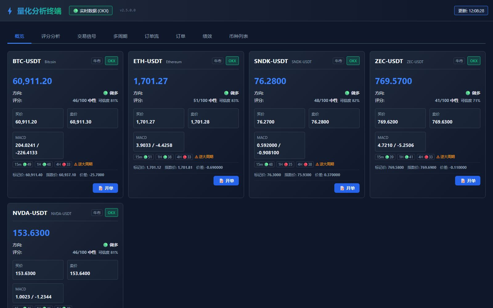

# OKEworkplace · 本地量化分析终端

一个运行在本机的加密资产分析工具：把实时行情、多周期趋势、订单流与风险信息集中到一处，帮助使用者形成结构化判断，并记录、复盘自己的交易决策。

> 仅用于分析与研究，**不自动下单、不托管资金、不构成投资建议**。所有交易决策与风险由使用者自行承担。



## 主要能力

- **实时行情**：主流币种价格、涨跌与关键位监控，断流时保留上次结果并标注数据时间。
- **评分与方向**：多维度综合打分，输出看多 / 看空 / 中性结论及触发原因。
- **多周期视角**：短、中、长周期分别判断，提示周期之间的共振与分歧。
- **订单流**：主动买卖量、大单与盘口失衡，观察短期资金压力。
- **手工记账与风控**：记录自己的开平仓、止盈止损，汇总持仓风险与集中度。
- **决策追溯与复盘**：保留历史判断依据，按方向、周期等维度统计胜率与盈亏表现。

## 技术栈

- 后端：Python · FastAPI · SQLite
- 前端：原生 ES Module 单页界面，无需构建
- 桌面：本地窗口运行，数据全部保存在本机

## 快速开始

```bash
python -m venv .venv
.venv\Scripts\activate
pip install -r backend/requirements.txt
copy backend\.env.example backend\.env
```

启动开发服务：

```bash
cd backend
..\.venv\Scripts\python.exe -m uvicorn app.main:app --host 127.0.0.1 --port 8010
```

打开 `http://127.0.0.1:8010` 即可使用。

## 说明

- 项目数据与配置均只保存在本地，不会上传到任何服务器。
- 不保存、不打印、不提交任何 API 密钥等敏感信息。
