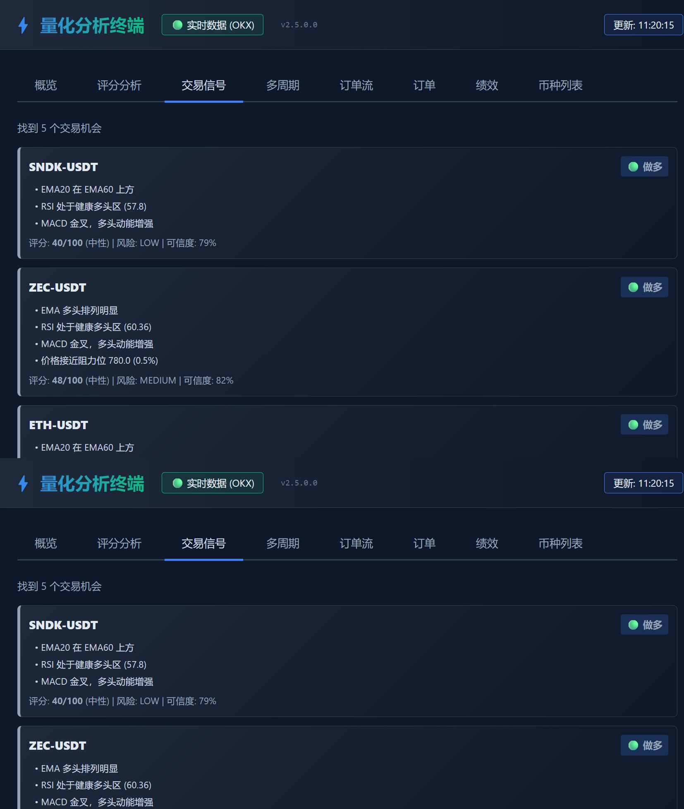
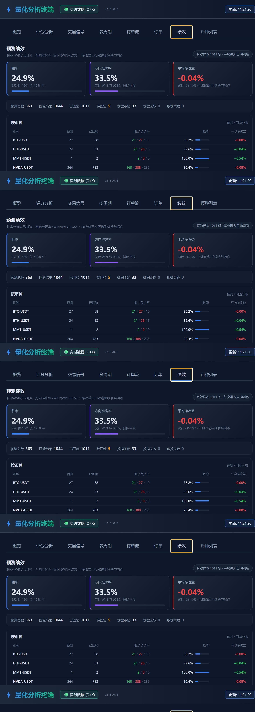

# 量化分析终端 · OKEworkplace

一个面向 **OKX 永续合约** 的本地量化分析终端：实时行情 → 五维评分 → 方向判定 → 决策追溯 → 多周期/订单流验证 → 手工记账与风控 → 绩效复盘。

> **定位**：只做分析与决策辅助，**不自动下单、不托管资金、不提供投资建议**。
> 手工交易在 OKX 手机端完成，本程序负责给出结构化判断与风险提示。

<p>
  
  
  
  
  
</p>

---

## 界面预览

### 概览：实时行情与当期评分


### 交易信号：方向、评分与触发条件


### 多周期：15m / 1H / 4H 共振与分歧


### 订单流：买卖压力与 CVD


### 订单与风控：组合风险、手工持仓、止损止盈


### 绩效：胜率、盈亏、上下文分桶


---

## 功能总览

| 模块 | 说明 |
|---|---|
| 实时行情 | OKX 公共行情，代理自动回退；断流保留上次值并标注数据年龄 |
| 五维评分 | 趋势 30 / 动量 20 / 成交量 20 / 持仓量 20 / 资金费率 10，输出 0-100 分 |
| 方向判定 | EMA / RSI / MACD 与 OI 共振，附稳定性与确认机制（冻结区，改动需专项授权） |
| 多周期 MTF | 15m / 1H / 4H 独立评分与方向，标注周期分歧与逆大周期风险 |
| 订单流 | REST 采样主动买卖量、买卖盘不平衡与 CVD（window / session），带缺口与过期标记 |
| 手工订单与风控 | 本地记账、止损止盈、价格触及提醒、组合名义价值/集中度/单笔风险占比 |
| 绩效复盘 | 胜率、盈亏比、期望、最大回撤、按上下文（方向/评分/周期）分桶 |
| 决策追溯 | 每次方向变化记录触发条件，支持事后解释与回看 |
| 历史与备份 | 信号采样入库、WAL 并发、三库自动备份与保留清理 |
| 回测与研究 | 历史 K 线重放现有评分，输出胜率/期望/盈亏比/回撤与基线对照 |
| 实盘只读 | 私有只读客户端 + 账户快照/持仓/成交/风险/对账，**当前默认关闭** |
| 影子评分 | 强度感知的 OI 分只做并行记录，**不参与任何判断** |

---

## 当前状态（重要）

- 版本：`VERSION = 2.5.0.0`，当前为测试版，未打包发布。
- **实盘 Tab 默认隐藏**：`OKE_PRIVATE_READ_ENABLED=false`，不注册账户调度、不创建空库、前端不显示入口。
  配好只读 Key（固定出口 IP 白名单）后置为 `true` 即可恢复。
- **P2 账户风险/对账未经真实数据验收**：因 OKX 出口 IP 变动导致 401，仅完成离线单测与渲染验证。
- **影子评分不参与正式判断**：`score / direction / level / risk` 全部走原路径，冻结区零改动。
- 资金费率历史接口实际只有最近 **100 条（约 33 天）**，OI 历史约 **30 天**；长周期回测无法包含这两个维度。
- 回测结论：当前评分**没有稳定可交易的正向 edge**，详见 [第 8 步实验记录](docs/第8步_回测与评分实验_20261126.md)。

---

## 快速开始

### 环境

- Python 3.10+
- 依赖见 `backend/requirements.txt`
- 可选：本机 HTTP 代理（默认探测 `127.0.0.1:12334`，不可用时自动尝试直连）

```bash
python -m venv .venv
.venv\Scripts\activate          # Windows
pip install -r backend/requirements.txt
copy backend\.env.example backend\.env
```

### 开发模式

```bash
cd backend
..\.venv\Scripts\python.exe -m uvicorn app.main:app --host 127.0.0.1 --port 8010
```

打开 `http://127.0.0.1:8010`。`?dev=1` 可开启前端文件变更自动刷新（正式版无此参数）。

### 桌面窗口模式

```bash
cd backend
..\.venv\Scripts\pythonw.exe ..\entry_exe.py
```

入口会探测可用端口（8000 被占用时顺延），并注入一次性本地 token。

### 打包

```bash
pyinstaller OKEworkplace.spec
```

打包只包含 `.env.example`；真实 `.env`、数据库与日志不会进入产物。

---

## 五维评分

| 维度 | 权重 | 主要输入 |
|---|---|---|
| 趋势 | 30 | EMA 排列、价格位置、关键位 |
| 动量 | 20 | RSI、MACD 柱与交叉 |
| 成交量 | 20 | 量比、放量方向一致性 |
| 持仓量 | 20 | OI 变化率（15m 周期取 15 分钟，1H/4H 取 1 小时） |
| 资金费率 | 10 | 当前费率与拥挤度反向修正 |

输出：`score`（0-100）、`direction`（LONG / SHORT / NEUTRAL）、五维分量、触发条件。
评分函数位于冻结区（`backend/app/model/market_score.py`、`services/signal_engine.py`），
权重与阈值调整必须单独立项并明确授权。

---

## 项目结构

```
OKEworkplace/
├─ backend/
│  ├─ app/
│  │  ├─ core/            # 配置、日志、启动参数
│  │  ├─ model/           # 冻结区：评分模型、分析结果结构
│  │  ├─ routes/          # analysis / mtf / orderflow / risk / account / predictions / system
│  │  ├─ services/        # 行情、指标、信号、存储、备份、账户、影子评分、维护任务
│  │  └─ main.py          # FastAPI 入口、路由注册、调度器
│  ├─ tests/              # 离线单测（账户、存储、路由、OI 口径、影子评分、启动隔离）
│  ├─ tools/
│  │  └─ backtest_replay.py   # 历史 K 线回测（只读复用评分）
│  └─ data/               # 运行态数据库与备份（不入库）
├─ frontend/
│  ├─ index.html          # 单页壳 + Tab 容器
│  └─ src/
│     ├─ api/ stores/ render/ views/ utils/   # 原生 ES Module，无构建
├─ docs/                  # 方案、交接文档、实验记录、界面截图
├─ entry_exe.py           # 桌面窗口入口
└─ OKEworkplace.spec      # PyInstaller 配置
```

### 运行态数据

| 文件 | 内容 |
|---|---|
| `backend/data/signals.db` | 信号采样、决策追溯、上下文分桶、订单流采样、影子评分 |
| `backend/data/user_trades.db` | 手工订单与平仓记录 |
| `backend/data/live_account.db` | 账户快照/成交/配置缓存（仅实盘只读启用时创建） |
| `backend/data/backups/` | 三库备份，按前缀与 `keep` 策略清理 |

所有库使用 WAL + `busy_timeout`；备份带表行数签名，恢复前会自动校验。

---

## 主要接口

| 分组 | 示例 |
|---|---|
| 行情与快照 | `/api/monitor/snapshot`、`/network/status` |
| 单币分析 | `/api/analysis/{symbol}` |
| 多周期 | `/api/v3/mtf/...` |
| 订单流 | `/api/v3/orderflow/...` |
| 风控与手工单 | `/api/v3/risk/...` |
| 绩效 | `/api/v3/performance/context-summary` |
| 实盘只读（默认关闭） | `/api/v3/account/status|summary|positions|margin|fills|config|risk|reconciliation` |

- 完整列表以 FastAPI 自动文档为准：`http://127.0.0.1:<port>/docs`。
- 本地 token：桌面壳通过 URL 注入 `window.__OKE_TOKEN`，写请求与账户路由自动携带 `x-oke-token`；
  未配置 `OKE_LOCAL_TOKEN` 时校验自动跳过。

---

## 配置

核心变量（详见 `backend/.env.example`）：

| 变量 | 默认 | 说明 |
|---|---|---|
| `OKE_BASE_URL` | OKX | 行情/公共接口地址 |
| `OKE_LOCAL_TOKEN` | 空 | 本地接口 token；空则不校验 |
| `OKE_PROXY_*` | 自动 | 代理探测与回退 |
| `OKE_PRIVATE_READ_ENABLED` | false | 实盘只读总开关 |
| `OKE_PRIVATE_READ_API_KEY/SECRET_KEY/PASSPHRASE` | 空 | 只读子账户凭证 |
| `OKE_DISABLE_SCHEDULER` | 0 | 测试/离线启动时禁用调度器 |
| `OKE_ORDERFLOW_RETENTION_DAYS` | 7 | 订单流采样保留天数 |
| `OKE_ACCOUNT_RECONCILE_TOLERANCE_PCT` | 20 | 本地/实盘对账容差 |

`.env` 已在 `.gitignore` 中；明文凭证文件（如 `api keys/`、`*api*.txt`）也被忽略，但仍建议不要放进仓库目录。

---

## 测试

```bash
# 逐文件运行（均为纯离线，不发起真实 OKX 请求）
python backend/tests/test_private_client.py
python backend/tests/test_account_store.py
python backend/tests/test_account_service.py
python backend/tests/test_account_routes.py
python backend/tests/test_maintenance.py
python backend/tests/test_app_startup.py
python backend/tests/test_oi_change.py
python backend/tests/test_shadow_score.py

# 或使用 pytest
python -m pytest backend/tests -q
```

测试通过 `OKE_DISABLE_SCHEDULER=1` 与假响应隔离，不会注册生产调度、不会触达外部网络。

---

## 回测

```bash
cd backend

# 全历史（OI / funding 均按 0）
python tools/backtest_replay.py

# 最近 30 天，OI 使用真实历史
python tools/backtest_replay.py --days 30 --oi

# 再加真实资金费率（实际只有约 33 天）
python tools/backtest_replay.py --days 30 --oi --funding
```

- 结果默认输出 `backend/data/backtest_results.json`（运行态，不入库）。
- 结论与数据边界见 [第 8 步实验记录](docs/第8步_回测与评分实验_20261126.md)。

---

## 文档

| 文档 | 内容 |
|---|---|
| [交接文档](docs/交接文档.md) | 项目全貌、历史阶段、当前状态与文件地图 |
| [给 GPT 协作者](docs/交接文档_给GPT协作者_20261124.md) | 外部协作者上手说明、边界与禁止事项 |
| [第 5 步](docs/第5步_多周期_风险管理_订单流_设计与范围.md) | 多周期、风控、订单流设计与实施状态 |
| [第 6 步](docs/第6步_决策追溯_绩效分桶_历史入库_范围与规划.md) | 决策追溯、绩效分桶、历史入库规划 |
| [第 7 步](docs/第7步_实盘只读实施方案与GPT方案评审.md) | 实盘只读方案、接口契约与实施状态 |
| [第 8 步](docs/第8步_回测与评分实验_20261126.md) | 回测方法、两轮结论、OI/funding 边界、影子评分 |

---

## 安全与合规

- 不保存、不打印、不提交任何 API Key / Secret / Passphrase / 签名。
- 实盘只读使用独立子账户与固定出口 IP 白名单，且默认关闭。
- 不自动下单，不修改 OKX 账户设置，不做资金划转。
- 所有分析结论仅供研究参考，交易决策与风险由使用者自行承担。

## 版本

- 当前：`2.5.0.0`（2026-11-26）
- 本阶段重点：实盘只读与账户能力（默认关闭）、多周期/订单流/风控、绩效分桶、回测工具、OI 口径修正、影子评分双轨。
- 更早版本见 git 提交历史与 `docs/交接文档.md`。
